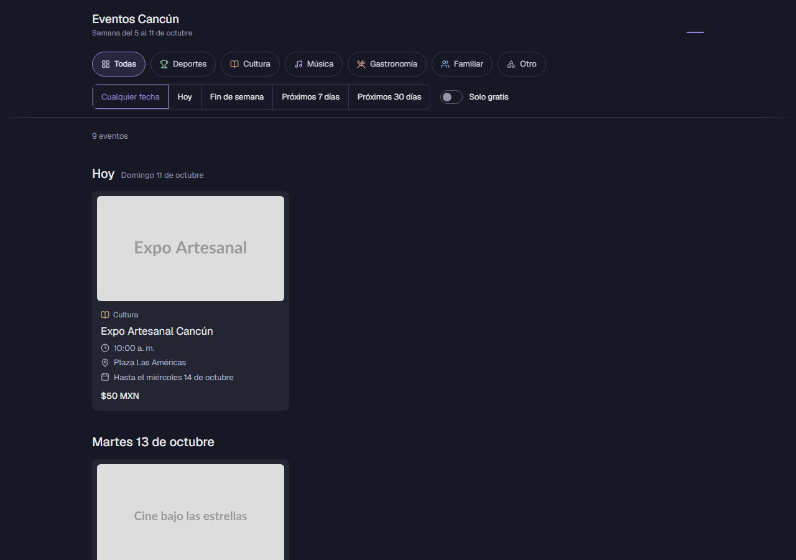
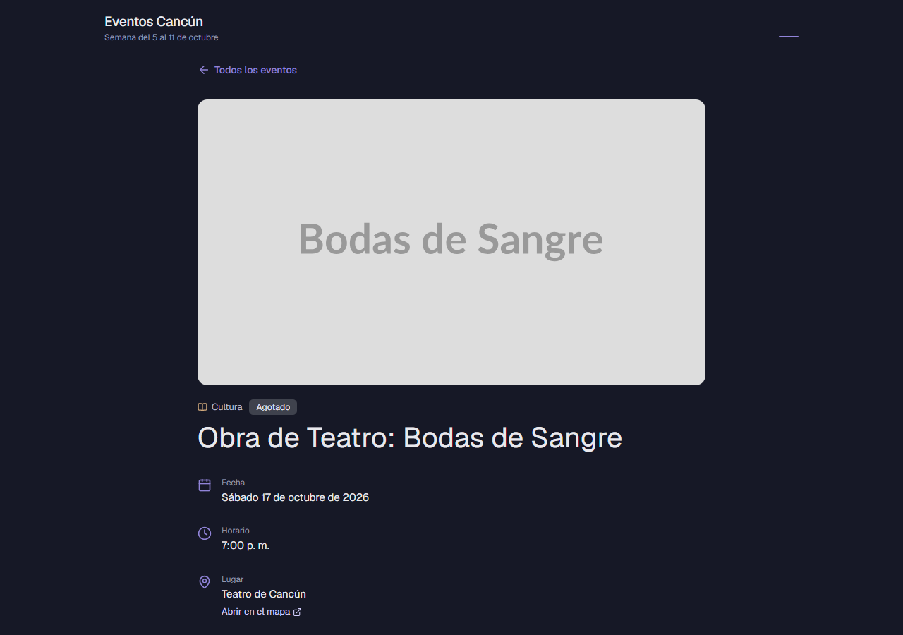
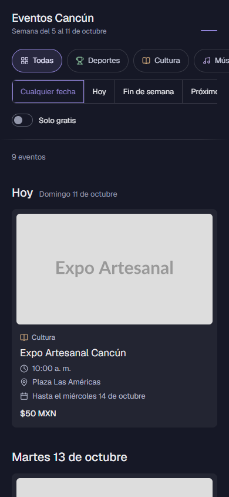

# Eventos Cancún

SPA de código abierto que muestra los eventos de la semana y del mes en Cancún — deportivos, culturales, musicales, gastronómicos, familiares y más — para que la gente pueda encontrar rápido qué hacer.

Sin backend propio: los datos vienen de datos de ejemplo (mock) o de un Google Sheet publicado como CSV.

**Demo en vivo:** [eventos-cancun.netlify.app](https://eventos-cancun.netlify.app/)

## Capturas

| Listado (escritorio)                                     | Detalle de evento                                            |
| -------------------------------------------------------- | ------------------------------------------------------------ |
|  |  |

**Listado (mobile)**



## Funcionalidad

- Listado agrupado por día ("Hoy", "Mañana", y después por fecha), ordenado por hora.
- Filtros por categoría, rango de fechas (hoy, fin de semana, próximos 7/30 días) y "solo gratis", sincronizados con la URL.
- Página de detalle por evento, con enlace compartible permanente.
- Estados capturados (cancelado, pospuesto, reprogramado, agotado) y calculados (próximo, en curso, finalizado) manejados por separado.
- Todas las fechas/horas se interpretan y muestran en la zona horaria de Cancún, sin importar dónde esté la persona que abre la página.
- Estados de carga (skeletons), vacío y error, y una página 404 propia.
- Mobile-first y accesible: HTML semántico, foco de teclado visible, contraste verificado, `prefers-reduced-motion` respetado.

## Stack

| Área                | Herramienta                                            |
| ------------------- | ------------------------------------------------------ |
| Build               | Vite                                                   |
| UI                  | React + TypeScript (modo `strict`)                     |
| Routing             | React Router v8 (modo declarativo)                     |
| Estado del servidor | TanStack Query                                         |
| Estado de filtros   | Search params de la URL                                |
| Estilos             | Tailwind CSS v4                                        |
| Componentes         | shadcn/ui (Base UI + preset Nova)                      |
| Validación de datos | Zod                                                    |
| Fechas              | date-fns + `@date-fns/tz`                              |
| Parseo de CSV       | PapaParse                                              |
| Pruebas             | Vitest + React Testing Library                         |
| Calidad             | ESLint + Prettier                                      |
| Deploy              | Netlify                                                |
| Imágenes            | Cloudinary (optimizadas automáticamente al mostrarlas) |

## Cómo correr el proyecto

Requisitos: [Node.js](https://nodejs.org/) 24 o superior y [Git](https://git-scm.com/).

```bash
git clone https://github.com/mauriciodeleonm/eventos-cancun.git
cd eventos-cancun
npm install
npm run dev
```

Abre la URL que aparece en la terminal (normalmente `http://localhost:5173`). Sin ninguna configuración adicional corre con datos de ejemplo.

### Otros comandos

```bash
npm run build        # build de producción
npm run preview      # previsualizar el build
npm run test:run     # pruebas (Vitest)
npm run lint         # ESLint
npm run format       # Prettier
```

## Fuente de datos

Por defecto el proyecto corre con datos de ejemplo (`mock`), sin configuración adicional. Si quieres usar tu propio Google Sheet como fuente:

1. Copia `.env.example` a `.env.local`.
2. Pon `VITE_DATA_SOURCE=sheet`.
3. Publica tu Sheet como CSV y pon esa URL en `VITE_EVENTS_CSV_URL`.

```bash
cp .env.example .env.local
```

### Estructura del Google Sheet

Una pestaña llamada **`Eventos`** (la única que se publica como CSV) con estos encabezados exactos en la fila 1, en este orden:

```
id	name	startDate	endDate	venueName	mapsUrl	price	priceNote	description	imageUrl	officialUrl	category	status
```

| Columna       | Obligatoria | Formato / valores válidos                                                                                                   |
| ------------- | :---------: | --------------------------------------------------------------------------------------------------------------------------- |
| `id`          |     Sí      | Texto único. Se genera solo (ver Apps Script abajo); no se edita a mano.                                                    |
| `name`        |     Sí      | Texto libre.                                                                                                                |
| `startDate`   |     Sí      | `YYYY-MM-DDTHH:mm`, o `YYYY-MM-DD` si la hora no está confirmada.                                                           |
| `endDate`     |     No      | Mismo formato que `startDate`. Vacío si el evento es de un solo día.                                                        |
| `venueName`   |     Sí      | Texto libre.                                                                                                                |
| `mapsUrl`     |     No      | URL de Google Maps. Si está vacía, se genera una a partir de `venueName`.                                                   |
| `price`       |     No      | Número, `0` o `gratis` (= gratis), o vacío (costo desconocido). Nunca asumas `0`.                                           |
| `priceNote`   |     No      | Texto libre, ej. "Preventa $350, taquilla $450".                                                                            |
| `description` |     Sí      | Texto libre.                                                                                                                |
| `imageUrl`    |     No      | Una o varias URLs de imagen separadas por coma. Si está vacía o no carga, se muestra un ícono de la categoría.              |
| `officialUrl` |     No      | URL del sitio oficial o venta de boletos.                                                                                   |
| `category`    |     Sí      | Uno de: `deportes`, `cultura`, `musica`, `gastronomia`, `familiar`, `otro`.                                                 |
| `status`      |     No      | Uno de: `cancelado`, `pospuesto`, `reprogramado`, `agotado` (no distingue mayúsculas/acentos/espacios). Vacío = programado. |

**Importante:** las columnas `startDate`/`endDate` deben estar formateadas como **texto sin formato** (Formato → Número → Texto sin formato) antes de escribir las fechas — si no, Google Sheets las reinterpreta como su propio tipo de fecha/hora y las exporta en un formato distinto al que espera la app.

**Imágenes:** sube el flyer (o varios) a tu cuenta de [Cloudinary](https://cloudinary.com) (plan gratis) y pega en `imageUrl` la URL que te da, tal cual (sin agregarle parámetros) — la app inserta las transformaciones de optimización (`f_auto,q_auto,w_600`) automáticamente al mostrarla. Si subes más de una foto, pega todas las URLs en la misma celda separadas por coma: la primera se usa como vista previa en el listado, y en la página de detalle se muestran todas como un carrusel. Evita links de Google Drive, Facebook o Instagram: no están pensados para incrustarse directamente y fallan o expiran.

Las filas inválidas (campo obligatorio vacío, categoría/estado que no están en la lista, id duplicado) se descartan al cargar, sin romper la app — se registra un aviso en la consola del navegador.

### Generar los ids automáticamente (opcional)

En **Extensiones → Apps Script** de tu Sheet, puedes agregar un disparador `onEdit` que genere el `id` solo cuando escribes un `name` sin `id` (slug del nombre + sufijo aleatorio de 4 caracteres). Pide el script en el proyecto si lo necesitas.

### Publicar como CSV

**Archivo → Compartir → Publicar en la web** → selecciona la pestaña `Eventos` → formato **CSV** → Publicar. Copia la URL resultante en `VITE_EVENTS_CSV_URL`. Ten en cuenta que esa URL hace público el contenido de esa pestaña.

## Contribuir

Las contribuciones son bienvenidas. El flujo general:

1. Haz un fork y crea una rama a partir de `main`.
2. Antes de abrir un PR, corre `npm run format`, `npm run lint`, `npm run test:run` y `npm run build` — todos deben pasar.
3. Los commits siguen [Conventional Commits](https://www.conventionalcommits.org/) (`feat:`, `fix:`, `chore:`, `test:`, `docs:`, `refactor:`, `style:`), en inglés.
4. Abre el PR describiendo el cambio y por qué.

## Licencia

[MIT](LICENSE)
